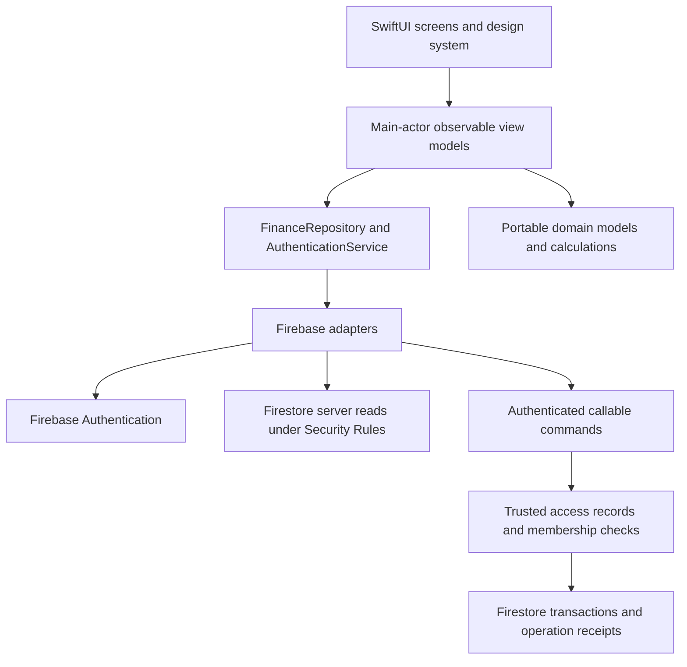

# Architecture

The existing domain package is preserved and extended. It imports Foundation and
Swift Testing only, with no SwiftUI or Firebase dependencies. The app targets iOS
17 or later. Swift language mode 6 and strict concurrency are configured in the
XcodeGen project specification.

## Domain layer

Models use integer RWF values, Codable serialization and Sendable. Calculators
validate records, reject duplicate identifiers and mixed ownership, and report
overflow. Monthly budgets and reports receive an explicit reporting time zone.
Recurrence projections retain the original anchor when projecting multiple dates.
User-facing domain errors are centralized in `DomainErrorDescriptions.swift`.

Existing mutable models remain compatible with prior construction patterns.
Construction and Codable decoding do not validate automatically; callers must use
`FinanceValidator` or a validating repository. Low-level Budget/SavingsGoal
arithmetic helpers assume validated values. The in-memory transaction repository
supports concurrency-safe CRUD and revisions for portable development.

## iOS MVVM

- `SessionViewModel` owns authentication state and clears protected navigation
  when signed out. Generation checks reject stale profile loads after identity
  changes. A failed profile initialization offers retry without exposing tabs.
- `FinanceViewModel` owns personal finance snapshots and calculated summaries.
- `WalletViewModel`, `AdviceViewModel` and `AdminViewModel` own collaboration and
  privileged workflows. Views contain no Firebase queries.
- `FinanceRepository` and `AuthenticationService` are injected protocols. The
  production adapters use Firebase; iOS tests inject a mock repository.
- New commands have stable operation identifiers. Ambiguous failures retain the
  original command and block unrelated writes until retry resolves it. Definite
  validation failures can be corrected. A failed read after a successful command
  only retries the read, never replays the mutation.

Requests in progress disable mutation controls. Repository refresh and mutations
are serialized at the view-model boundary. Server revision checks handle changes
from other devices. Data refresh occurs on pull-to-refresh, screen entry and
foregrounding; advisor detail views refresh every 30 seconds. This implementation
does not claim continuous real-time listeners or offline write synchronization.

Commands are bound to their originating account. Both the adapter and backend
compare `expectedUserID` with the current Firebase identity, preventing a queued
command from applying to a different account after sign-out/sign-in.

## Wire format and persistence

All date fields use numeric Unix **seconds** in Firestore and callable payloads.
The app JSON encoder/decoder explicitly selects `secondsSince1970`. Firestore
Timestamp values are not mixed into these model documents. Rules convert
`request.time` to seconds for consent expiry. Amounts are integers, with a backend
range of 1 through 9,000,000,000,000 RWF and checked aggregate limits. Progress
ratios and chart positions may use floating-point values; money does not.

Private records live under `users/{uid}`. Cloud record envelopes include revisions
and tombstones; existing model decoders ignore those extra fields. Tombstones and
per-owner operation receipts preserve concurrency and retry behavior. Do not
expire operation receipts without designing a replacement deduplication policy.

The app uses memory-only Firestore caching and server reads. Loading an account's
data is capped at 5,000 records per collection and explicitly fails above that
limit. Backend summary generation has the same bounded-query policy. Pagination
and large-account aggregation are future scaling work; records are not silently
truncated. Firestore automatically merges equality indexes for the current
queries; `firestore.indexes.json` is provided for future query changes.

Backend command logic is dependency-injected in `command-handler.js`, with a thin
Firebase transport in `index.js`. Unit tests use a transactional test double to
exercise the actual handlers and enforce reads before writes. Emulator suites
remain necessary to validate real Firestore transactions, Rules and Auth behavior.

## Financial workflows

Saving a record verifies owner access, schema, revisions and immutable server
creation dates. The backend ignores client roles, owner IDs and goal saved totals.
Savings contributions atomically append history and update the goal total/status.
Bill payments atomically append a payment, create an immutable expense, and advance
the durable schedule. Receipts also prevent a manually reset due date from paying
the same occurrence twice. Bill recurrence uses a Kigali calendar-day anchor.

Savings contributions track progress; they do not deduct from personal cash or
assert that funds were transferred to a bank account. Wallet contributions likewise
record a shared ledger and do not initiate real money transfers. Wallet expense
splitting and settlement are not implemented. Ledger writes remain disabled until
the contribution-pool model is explicitly confirmed.

## Presentation

The design system uses navy, emerald and indigo with semantic system surfaces.
Personal navigation contains Home, Transactions, Budgets, Wallets and Profile.
Advisor and administrator roles receive their own first tab, retaining access to
personal features through Home/Profile. Forms use native controls, confirmations,
integer amount entry, accessible labels, and text alternatives to charts. Reporting
uses Africa/Kigali consistently. There are no custom motion effects that bypass
Reduce Motion settings.
